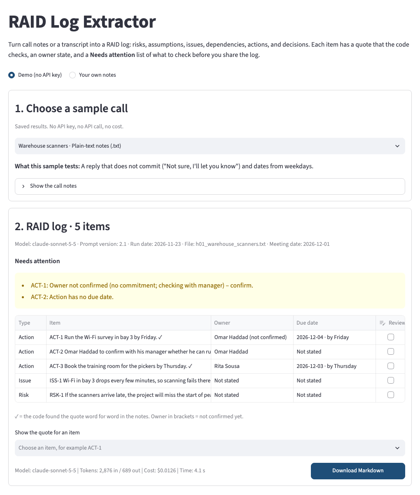
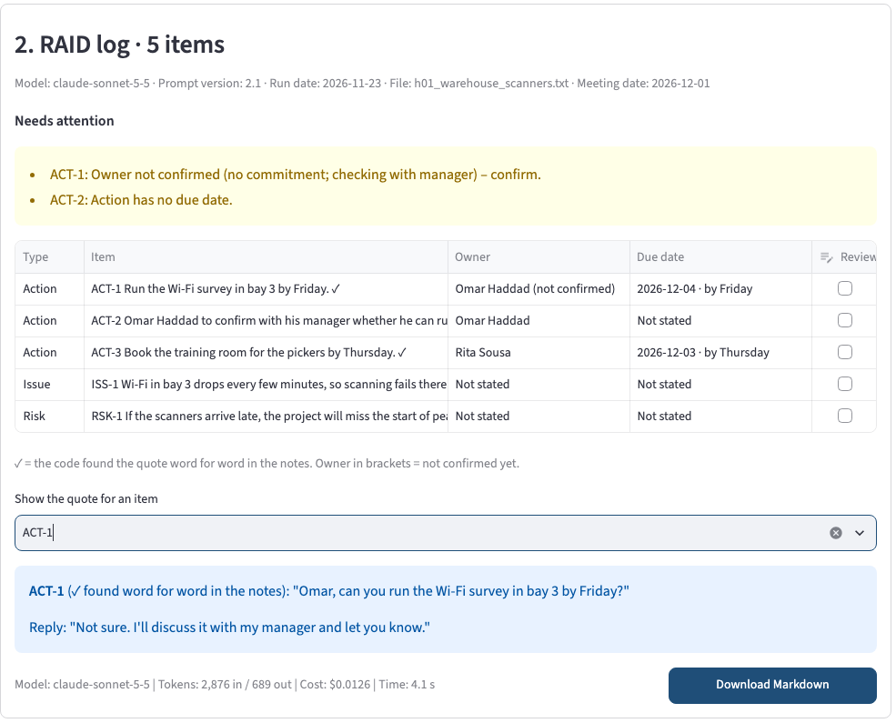
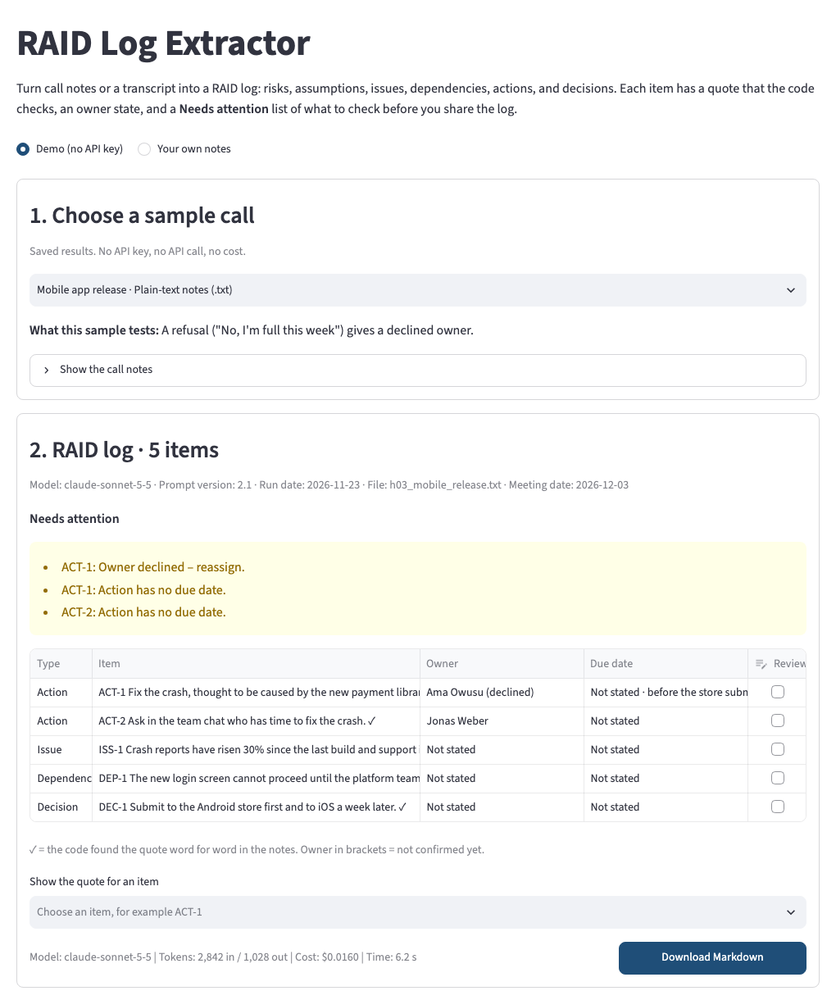

# RAID Log Extractor

[](https://github.com/aswinguruswamy/raid-log-extractor/actions/workflows/tests.yml)

Turn the notes from a team call into a RAID log in less than one minute.

**[Try the live demo](https://raid-log-extractor.streamlit.app/)**: no sign-in and no API key.

## Known limits

- **The held-out score is on 28 calls written by Claude (AI).** Aswin Guruswamy approved every answer key before the first run, and no held-out call was used to tune the prompt. But the tool also uses Claude, so these calls may be easier than real notes. 28 calls (one per hard case) show a direction, not a statistical proof.
- **The 100% tuning score is on the 10 calls that the prompt was tuned on.** Use the held-out score for new notes.
- **Recall on new calls is about 95%.** The misses are of three kinds: tasks that nobody owns and that are said as a plan ("the audit folder must be ready", "that goes into the next sprint"), a "decide later" step after a decision was put off, and a few issues or dependencies said in passing.
- **Some due dates are missed, never invented.** On the held-out set the tool gave 138 of the 149 due dates in the answer keys (93%). The other 11 show "Not stated"; no date was wrong or invented.
- **English only.** Notes that do not look like English get a warning.
- **One call per run.** The tool does not merge a new call into an existing log.
- **Long notes:** more than 15,000 words gets a warning. An answer cut off at the output limit is an error with no log ("split the notes"); the tool does not split them for you.
- **Dates:** the code converts "by Friday", "2 November" and full dates with the meeting date. It writes "Not stated" (and keeps the words) for number-only dates ("02/11"), "next Friday", "next sprint", "end of month" and events ("after the release"). A day and month more than 30 days before the meeting take the next year.
- **Speakers:** the tool cannot see a wrong speaker label in a transcript. An owner taken from a one-word reply ("Yes.") gets a check line in Needs attention.
- **Page:** you see an item's quote by choosing the item in a box under the table (a table cell cannot be clicked). The Reviewed ticks last for the page session only; the Markdown download keeps them.
- **Privacy:** your notes go to the Anthropic API. Do not upload notes that you may not share.

## Screenshots

From the keyless demo ([open it](https://raid-log-extractor.streamlit.app/)); no API key, saved results.

**1. Needs attention and owner states.** "Warehouse scanners": Omar replied "Not sure. I'll discuss it with my manager and let you know." He is *not confirmed*, Needs attention says so, and "by Friday" becomes 2026-12-04 from the meeting date (Tue 1 Dec). Rita said yes, so she is confirmed. [Open this sample](https://raid-log-extractor.streamlit.app/?demo=h01_warehouse_scanners)



**2. The quote behind an item.** Choose ACT-1 in "Show the quote for an item": the request and Omar's reply, found word for word in the notes. "Download Markdown" saves the table with your Reviewed ticks and the quotes.



**3. A refusal.** "Mobile app release": Ama said "No, sorry, I'm full this week." She is *declined*, and Needs attention says "reassign". [Open this sample](https://raid-log-extractor.streamlit.app/?demo=h03_mobile_release)



## The problem

After a project call, a project manager writes the RAID log by hand. My own timed test took 6 to 8 minutes for a short call of about 150 words. With the tool, the log and my check of every item took about 27 seconds ([`evals/review_times.json`](evals/review_times.json)). Items get lost, and owners and dates get guessed.

The main risk of an AI tool here is a log that looks correct but is wrong. So every item has a source quote that the code checks against the notes, and the tool writes **"Not stated"** instead of a guess. The reasons and trade-offs are in [`docs/product-decisions.md`](docs/product-decisions.md).

## What it does

The tool reads the notes from a team call (.txt, .docx, or a Teams/Zoom .vtt transcript). It finds six item types:

| Type | Example |
|---|---|
| Risk | "The vendor may not deliver the API in time." |
| Assumption | "We assume that the test data is ready by Friday." |
| Issue | "The staging server is down." |
| Dependency | "The release needs sign-off from the security team." |
| Action | "Priya will send the migration plan by Monday." |
| Decision | "We will use PostgreSQL for the new service." |

Each item has an owner, a due date and a **source quote** from the notes. The code checks each quote word for word against the notes.

### What v2 adds

- **Owner states.** An owner is **Confirmed** only after a clear yes or an "I will". "I can try" is **Tentative**, "No" is **Declined**, and no reply, a withdrawn yes, a list of names or a person not on the call is **Not confirmed**. The page shows the state next to the owner: "Aiko (tentative)".
- **Decisions need agreement.** "We could use Postgres" is not a decision. "We'll go with X if the VP agrees" is a dependency on that approval.
- **Dates from code.** The model copies the date words ("by Friday"); the code turns them into a date with the meeting date you enter.
- **Code checks before you see the log:** owner name not in the notes, owner or date far from the quote, date words not in the notes, duplicate items, an owner from a one-word reply.
- **Needs attention** above the log lists what to check: unconfirmed owners, actions with no due date, and the check results.
- **One table** (Type · Item · Owner · Due date · Reviewed), a **Markdown download** with run details and the quotes, and no Excel file.
- **Fail loudly:** an answer cut off at the output limit is an error, not a short log.

## Eval results

Model `claude-sonnet-5-5`, prompt 2.1. The same v2 metrics for every set ([`raid/evaluate.py`](raid/evaluate.py)).

| Set | Calls | Written by | Recall | Precision | Invented owners | Invented dates | Wrong owners / dates | Owner state right | Found in all 5 runs | Cost |
|---|---|---|---|---|---|---|---|---|---|---|
| **Held-out** ([report](evals/heldout/report.md)) | 28 × 5 runs | Claude (AI); keys approved by Aswin Guruswamy before the run | **95%** | **99%** | **0** | **0** | 0 / 0 | 523 of 524 | 94% | $1.78 |
| Tuning ([report](evals/report.md)) | 10 × 1 run | AI-assisted (Claude), v1 | 100% | 100% | 0 | 0 | 0 / 0 | – (v1 keys have no states) | – | $0.15 |
| Spec examples ([report](evals/spec_cases/report.md)) | 13 × 1 run | Claude (AI), from the approved spec | 100% | 100% | 0 | 0 | 0 / 0 | 15 of 15 | – | $0.10 |

- **Release gate:** 0 invented owners and 0 invented dates on the held-out set, with the answer keys committed before the first run. Passed.
- **Invented owner:** the tool names a person as Confirmed or Tentative where the key has nobody, or has Not confirmed or Declined. **Invented date:** the tool gives a date where the key has "Not stated".
- Every pull request that changes the prompt, the code checks or the model runs the tuning calls and the spec examples in CI, and fails on any invented owner or date.
- The held-out set has one call for each of the 28 hard cases in the failure catalogue: non-committal replies, weak yes, refusals, conditions, counter-offers, no reply, withdrawn yes, hand-offs, lists of names, roles, people not on the call, same first names, unclear "he", relative and changed dates, proposals, reversed and pending decisions, negations, status-only calls, one-word replies, a long call, wrong-item quotes and a prompt-injection line.

## Quick start

You need Python 3.11 or later and an [Anthropic API key](https://console.anthropic.com).

```bash
git clone https://github.com/aswinguruswamy/raid-log-extractor.git
cd raid-log-extractor
python3 -m venv .venv && source .venv/bin/activate   # Windows: .venv\Scripts\activate
python3 -m pip install -r requirements.txt
cp .env.example .env    # then put your Anthropic API key in .env
```

**Web page:**

```bash
python3 -m streamlit run app.py
```

The demo mode needs no API key. The "Your own notes" mode uses the key in `.env`.

Enter the meeting date before you upload, so that "by Friday" becomes a date. [How to export a Teams or Zoom transcript](docs/export-guide.md).

**Command line:**

```bash
python3 -m raid extract samples/s02_crm_migration.txt --meeting-date 2026-10-21
```

The Markdown file goes into the `output/` folder.

**Evals:**

```bash
python3 evals/run_eval.py --cached                        # re-score the saved tuning run, no API call
python3 evals/run_eval.py --set heldout --cached --gate   # the release gate on the saved held-out run
```

**Tests:**

```bash
python3 -m pytest          # offline tests, no API key
python3 -m pytest -m live  # live tests with your key (a few cents)
```

## How the project was run

A solo project, run as a small software project: a charter, a MoSCoW backlog in Jira, three 2-day sprints, a release gate, and a bug log with root causes.

| Document | What it shows |
|---|---|
| [`docs/product-decisions.md`](docs/product-decisions.md) | The product choices, the options not taken, and the trade-offs |
| [`evals/FINDINGS.md`](evals/FINDINGS.md) | What each eval run found and what changed |
| [`docs/corrective-actions.md`](docs/corrective-actions.md) | Every bug, with the root cause, the fix, and the prevention |
| [`docs/project-raid-log.md`](docs/project-raid-log.md) | The RAID log of this project itself |
| [`docs/release-gate-v1.0.md`](docs/release-gate-v1.0.md) | The checks that the release had to pass |
| [`docs/project-report.md`](docs/project-report.md) | The close report: plan against actual, delivery by sprint, bugs, and the 1.1 backlog |

Built with Claude as the coding partner; product decisions, evals, and testing by Aswin Guruswamy.

## Project structure

```
app.py              Streamlit web page (demo mode and your own notes)
raid/               the tool: parse, extract (prompt), dates, checks, pipeline, view, Markdown export,
                    cost, command line, eval scoring
samples/            10 tuning calls with invented names (no real data)
evals/              tuning answers and runs; spec_cases/ (spec examples); heldout/ (28 held-out calls,
                    approved keys, 5-run outputs, report); eval script and findings
specs/              approved v2 spec, requirements and constitution
scripts/            release notes; demo builder
demo/               saved v2 results that the demo mode shows
docs/               decisions, bug log, project RAID log, release gate, demo GIF
tests/              offline tests and live tests
.github/workflows/  CI: offline tests (Python 3.11-3.14), scans, live eval on prompt changes, held-out run, release
.streamlit/         web page settings (upload limit, colours)
```

## Privacy

The tool sends the text of your notes to the Anthropic API. It does not store the notes or your key. Do not use notes that your company or client does not permit you to share with a third-party service.

## License

MIT
