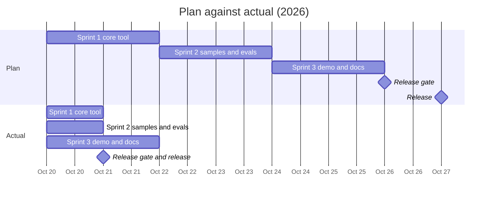

# Project close report: RAID Log Extractor v1.0

**Status:** version 1.0 released on 2026-10-21 · **Owner:** Aswin Guruswamy · **Report date:** 2026-10-21

Version 1.0 delivered all 21 Must and Should sprint stories and met every quality target in the charter. The release came 6 days before the planned date, and 1 Could story moved to version 1.1.

**Sources:** the Jira project KAN (stories, sprints, bugs), the Git history of this repository, the eval reports, and [`corrective-actions.md`](corrective-actions.md). The numbers were taken from these records on 2026-10-21; the Jira site is private, so this report repeats what it holds. Times are Toronto time (UTC−4).

## Summary

| Area | Plan (charter) | Actual |
|---|---|---|
| Release date | 2026-10-27 | 2026-10-21, 6 days early |
| Scope | 22 sprint stories (21 Must or Should, 1 Could) | 21 Must and Should done; the Could story moved to 1.1 |
| Recall on risks, issues, dependencies, actions | 85% or more | 100% |
| Precision on all item types | 80% or more | 100% |
| Invented owners or dates | 0 | 0 |
| Time with the tool and a review, short call | Less than 5 min (stated for a 1-hour call) | About 27 s, against 6–8 min by hand; a 1-hour call was not timed |
| Time for a 1-hour transcript | Less than 60 s | 5.2 s |
| API cost for a 1-hour transcript | Less than $0.10 | $0.046 |
| API budget | $20 | Measured runs: $0.23 (eval runs 1 and 2, the 1-hour test). Live tests add a few cents; the Anthropic console has the exact total |
| Effort | 40 hours | Not recorded |

## Schedule

| Milestone | Plan | Actual (first and last commit) |
|---|---|---|
| Sprint 1: core tool | Oct 20–21 | Oct 20, 10:27–13:03 |
| Sprint 2: samples and evals | Oct 22–23 | Oct 20, 17:14–18:06 |
| Sprint 3: demo and documentation | Oct 24–25 | Oct 20, 18:12 – Oct 21, 07:57 |
| Release gate | Oct 26 | Oct 21, 08:11 (re-run 11:52 after the audit fixes) |
| GitHub release v1.0.0 | Oct 27 | Oct 21, 12:38 |

## Delivery by sprint

| Sprint | Stories planned | Done | Moved | Planned hours |
|---|---|---|---|---|
| Sprint 1: core tool (KAN-6 to KAN-14) | 9 | 9 | 0 | 13 |
| Sprint 2: samples and evals (KAN-15 to KAN-20) | 6 | 6 | 0 | 12.5 |
| Sprint 3: demo and documentation (KAN-21 to KAN-27) | 7 | 6 | 1 (KAN-27, Could) | 11 (12 with the Could story) |
| Release and close (KAN-28 to KAN-32) | 5 | 4 | 0 | 4 |
| **Total** | **27** | **25** | **1** | **40.5** |

Open: KAN-30 (add the project to the LinkedIn profile), after the release by the owner's choice. The release post in the original plan was dropped on 2026-10-21.

## Quality

| Measure | Result |
|---|---|
| Offline tests | 62 pass on Python 3.9 and 3.12; CI runs them on each push |
| Live tests (real API) | 7, run on the owner's computer |
| Eval set | 10 sample calls, 68 expected items; answers committed before the first run |
| Eval runs | 2 (run 1: recall 97%, precision 99%; run 2: 100% and 100%) |
| Release gate | 15 checks on a fresh clone; passed twice |

### Bugs

23 entries: 22 fixed and 1 accepted with no change; 0 open. Each one is in Jira (KAN-39 to KAN-61) and in [`corrective-actions.md`](corrective-actions.md) with its root cause, fix, evidence, and prevention step.

| Severity | Count | Fixed | Accepted |
|---|---|---|---|
| High: wrong output, privacy, or cost risk | 6 | 6 | 0 |
| Medium | 9 | 9 | 0 |
| Low | 8 | 7 | 1 |

| Where found | Count | Bugs |
|---|---|---|
| Live tests and real use on the owner's computer | 4 | BUG-01, 02, 03, 13 |
| Eval runs | 3 | BUG-04, 05, 06 |
| Page reviews with screenshots | 5 | BUG-09 to 12, 16 |
| Project reviews and the release audit | 11 | BUG-07, 08, 14, 15, 17 to 23 |

Every fixed bug was fixed on the day it was found. All 6 High bugs were fixed before the v1.0 release.

## Changes to the baseline

The charter change log holds the detail. In short:

1. Solo project, with three 2-day sprints (approved Oct 20).
2. Backlog, sprints, and bugs moved to Jira (Oct 20).
3. The Markdown export (Could) moved to version 1.1 (Oct 21).
4. No LinkedIn release post; the project goes into the LinkedIn profile (Oct 21).
5. The value metric was measured on short samples, not on a 1-hour call (Oct 21).

## Backlog for version 1.1

| Jira | Item | Priority |
|---|---|---|
| KAN-38 (L-06) | A held-out eval set: new samples, answers written first, never used to change the prompt | First |
| KAN-27 (L-07) | Markdown export | Could |
| KAN-33 (L-01) | Remove names from the notes automatically | Later |
| KAN-34 (L-02) | Sync the log to Jira or Asana | Later |
| KAN-35 (L-03) | Merge items across more than one call | Later |
| KAN-36 (L-04) | Languages other than English | Later |
| KAN-37 (L-05) | Live audio or a live call | Later |

## Lessons

From the retrospective in the case study and the root causes in the bug log:

1. Set the standards at the start (IDs, writing rules, documents, Jira bug steps), so that fewer corrections are needed later.
2. Plan first: give complete instructions before the build starts.
3. Test against the real service and on the user's own computer early. Two High bugs appeared only there.
4. Look at the output itself, not only the test results. Screenshots and a frame check found 5 bugs that the tests did not.
5. Keep the baseline documents up to date when a change happens.
